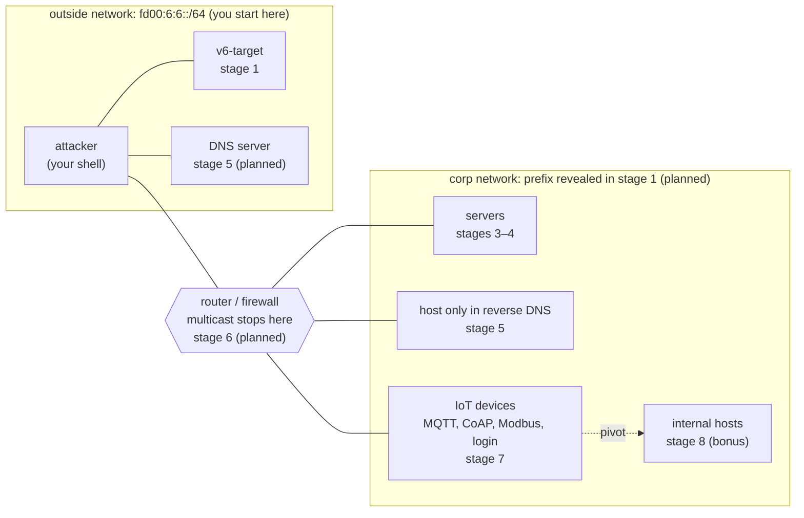

# Lab 3: CoolCorp HQ – IPv6 and IoT

> **Status:** work in progress. Stage 1 is playable now. Stages 3–8 are
> designed and listed below so you know what to expect; their targets are
> still being built.

> **Scenario.** After the incident in the cold-storage site (lab 1) you are
> sent to **CoolCorp HQ**. HQ runs IPv6, and its internal network sits behind
> a router. You start outside that network. Sweeping a /64 is hopeless, so you
> have to *find* addresses: by multicast, by guessing the admin's patterns, by
> asking DNS, and finally by looking at the IoT devices, where finding a device
> often means you already have access.

## Start

```bash
docker compose --profile lab3 up -d --build
docker compose exec attacker bash
```

## Networks

| Network | Range | Notes |
| --- | --- | --- |
| outside (`lab`) | `fd00:6:6::/64` | where you start |
| corp (planned) | revealed in stage 1 | behind a router, multicast does not cross it |



## Stages

| # | Stage | Technique | Status |
| --- | --- | --- | --- |
| 0 | Try it the IPv4 way | sweep an IPv4 /24 vs. an IPv6 /64, see why brute force fails | planned |
| 1 | Find me if you can | multicast discovery (`ff02::1`), neighbour cache, IPv6-only service | **playable** |
| 3 | Think like the admin | guessable addresses: low-byte, service ports, hex words, embedded IPv4 | planned |
| 4 | The address pool | sequential (DHCPv6-style) addresses: one hit, then the neighbours | planned |
| 5 | Ask the phone book | reverse DNS walk in `ip6.arpa` (NXDOMAIN vs. NOERROR) | planned |
| 6 | Two doors, one lock | dual-stack gap: filtered over IPv4, open over IPv6 | planned |
| 7 | Smart, not secure | find IoT devices via EUI-64 and vendor OUI, then MQTT, CoAP, Modbus and a default login with nmap NSE scripts | planned |
| 8 | Inside job (bonus) | pivot through an IoT device, then multicast discovery inside corp | planned |

(There is no stage 2: the recon stage was cut to keep the lab within about 25 minutes.)

## Stage 1 – Find me if you can

One host in the outside network listens only on IPv6, on an unusual port, and
its address cannot be guessed. Find it and fetch the flag.

1. Find every host on the link. Hint: `ff02::1`
2. Scan them with `nmap -6`. One port does not belong there.
3. Fetch the flag: `nc -6 <address> <port>`

Bonus: scan the same host via IPv4. What is different?

## Rules

Scan only the lab networks. No flooding (`-T5`, `ipv6-ra-flood` and similar).
