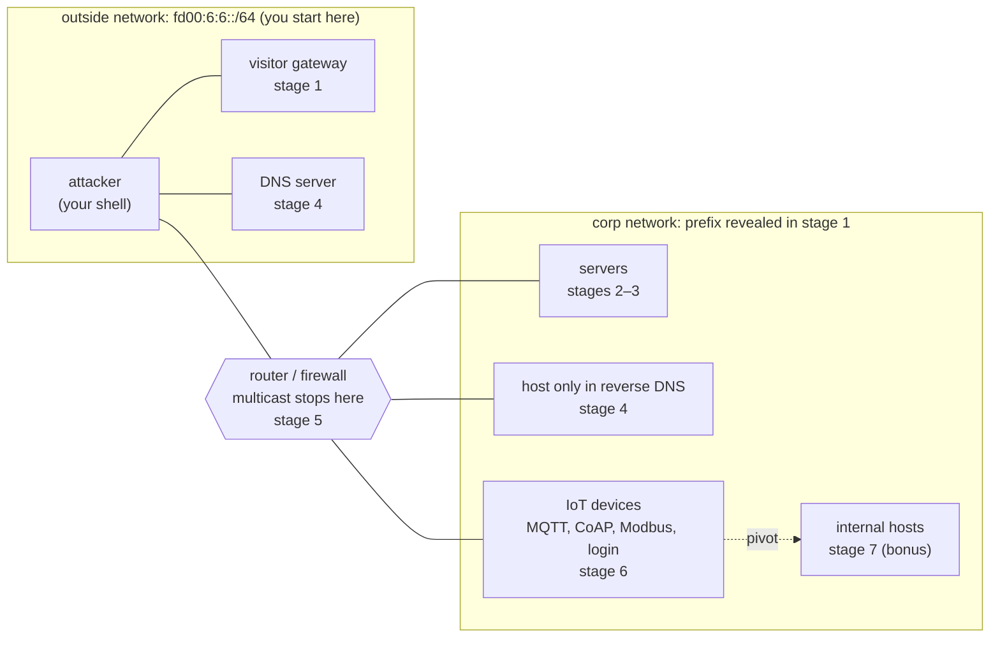

# Lab 3: CoolCorp HQ – IPv6 and IoT

> **Scenario.** After the incident in the cold-storage site (lab 1) you are
> sent to **CoolCorp HQ**. HQ runs IPv6, and its internal network sits behind
> a router. You start outside that network. Sweeping a /64 is hopeless, so you
> have to *find* addresses: by multicast, by guessing the admin's patterns, by
> asking DNS, and finally by looking at the IoT devices, where finding a device
> often means you already have access.

Every stage gives you a `FLAG{...}`. Stages 1–6 are the core of the lab
(about 25 minutes). Stage 7 is a bonus for fast teams. </br>
Stuck? See
[HINTS.md](HINTS.md), one hint per stage.

## Start

```bash
docker compose --profile lab3 up -d --build
docker compose exec attacker bash
```

You are now in the `attacker` container. All scans run from here.

## Networks

| Network | Range | Notes |
| --- | --- | --- |
| outside (`lab`) | `fd00:6:6::/64` (and `172.30.0.0/24`) | where you start |
| corp | revealed in stage 1 | IPv6 only, behind a router; multicast does not cross it |



## Stages

| # | Stage | Technique |
| --- | --- | --- |
| 0 | Try it the IPv4 way | why sweeping a /64 fails (warm-up, no flag) |
| 1 | Find me if you can | multicast discovery (`ff02::1`), neighbour cache, IPv6-only service |
| 2 | Think like the admin | guessable addresses: low-byte, service ports, hex words |
| 3 | The address pool | sequential (DHCPv6-style) addresses: one hit, then the neighbours |
| 4 | Ask the phone book | reverse DNS walk in `ip6.arpa` (NXDOMAIN vs. NOERROR) |
| 5 | Two doors, one lock | dual-stack gap: filtered over IPv4, open over IPv6 |
| 6 | Smart, not secure | find IoT devices via EUI-64 and vendor OUI, then MQTT, CoAP, Modbus and a default login with nmap NSE scripts (4 flags) |
| 7 | Inside job (bonus) | pivot through an IoT device, then multicast discovery inside corp |

### Two things you need all the time

- **Discover first, then scan ports.** `nmap -6 -sn` on a list of candidate
  addresses takes seconds. A port scan with `-Pn` on the same list waits for
  every address that does not exist and takes many minutes.
- **nmap has no ranges for IPv6** (`fd00:c::1-ff` does not work). Write the
  candidates into a file and use `-iL`:
  ```bash
  for i in $(seq 1 255); do printf 'fd00:c::%x\n' "$i"; done > /work/cand.txt
  nmap -6 -sn -iL /work/cand.txt
  ```

---

## Stage 0 – Try it the IPv4 way (warm-up)

```bash
nmap -sn 172.30.0.0/24
```

That took about two seconds for 256 addresses. A /64 has 2^64 addresses.
You can try running `nmap -6 -sn fd00:6:6::/64`, it won't finish.
For the rest of the lab you have to find addresses some other way.

## Stage 1 – Find me if you can

One host in the outside network listens only on IPv6, on an unusual port, and
its address cannot be guessed. Find it and fetch the flag.

1. Ask every host on the link to answer: `ping -6 -c2 ff02::1%eth0`.
   Then look at your neighbour cache: `ip -6 neigh`.
2. Scan the hosts you found with `nmap -6`. One port does not belong there.</br>
   **Remember:** Link-local addresses need the interface: `fe80::…%eth0`.
3. Fetch the flag: `nc -6 <address> <port>`

**Leave your own laptop out.** One neighbour is your Docker host, i.e. your
own computer; scanning it shows your own services, not the lab. It also owns
`fd00:6:6::1`: run `ping -6 -c1 fd00:6:6::1`, then `ip -6 neigh` shows its
MAC address, and you can skip the link-local address with the same MAC.
(Two neighbours are marked `router`: your Docker host and a real router.
Keep the real one in mind.)

The banner also tells you where the corp network is and which router leads
there. Your attacker has no route to it yet; add one:

```bash
ip -6 route add <corp prefix> via <gateway>
```

Bonus: scan the same host via IPv4. What is different?

## Stage 2 – Think like the admin

Nobody types random 64-bit interface IDs by hand. Admins pick addresses they
can remember: low numbers (`::1`, `::2`), the service port (`::25` for mail,
`::80` for web) or hex words (`::dead:beef`).

**Goal:** build a list of such candidates in the corp prefix, find the live
hosts, scan them. One of them is not a server at all; its banner has the flag.

## Stage 3 – The address pool

The intranet web server you found in stage 2 has more to say than its
front page shows. Read it carefully: it leaks one address from the new
DHCPv6 pool.

**Goal:** a server that hands out addresses one after the other leaves its
neighbours right next to the address you know. Find all of them; one of
them has the flag.

## Stage 4 – Ask the phone book

CoolCorp's DNS server is `fd00:6:6::53`. The forward zone `corp.lab` only
lists the official hosts, and zone transfers are blocked. But every IPv6
address can have a PTR record under `ip6.arpa`, one nibble (hex digit) per
label.

**Goal:** walk the reverse zone of the corp prefix and find a host that has
no forward record.

The trick (RFC 8020): ask for a partial name. If nothing exists below it, the
server says `NXDOMAIN`; if something exists further down, it says `NOERROR`.
So you only follow the branches that exist:

```bash
dig @fd00:6:6::53 <nibble>.<…>.c.0.0.0.0.0.d.f.ip6.arpa PTR
```

Shortcut once you have understood it: `atk6-dnsrevenum6`.

## Stage 5 – Two doors, one lock

The router between outside and corp has an admin interface. The admin
blocked it in the firewall. In *a* firewall.

**Goal:** compare `nmap -4` and `nmap -6` against the router's two outside
addresses and read the admin page. It has the flag and something you need for
stage 6.

## Stage 6 – Smart, not secure (4 flags)

A batch of IoT devices configures its addresses with SLAAC. Their interface ID
is built from the MAC address (EUI-64): split the MAC in the middle, insert
`ff:fe`, flip bit 0x02 of the first byte. Example:
`b8:27:eb:12:34:56` → `ba27:ebff:fe12:3456`.

**Goal:** use the clue from stage 5 and the vendor list in
`/usr/share/nmap/nmap-mac-prefixes` to compute the candidate addresses, find
the devices, then talk to each of them in its own protocol. nmap has an NSE
script for each one:

| Device | Port | NSE script | Client |
| --- | --- | --- | --- |
| MQTT broker | 1883/tcp | `mqtt-subscribe` | `mosquitto_sub` |
| CoAP sensor | 5683/udp | `coap-resources` | `coap-client-notls` |
| Modbus controller | 502/tcp | `modbus-discover` | `mbpoll`, `python3` + `pymodbus` |
| Web login | 80/tcp, 23/tcp | `http-brute`, `telnet-brute` | `curl`, `telnet` |

Remember UDP: `nmap -6 -sU -p5683 …`. For the brute-force scripts add
`--script-args brute.firstonly=true`, otherwise they keep going after the
first hit.

## Stage 7 – Inside job (bonus)

Outside the corp network, `ff02::1` only reached the outside hosts. One of
the IoT devices gives you a shell.

**Goal:** log in, then do stage 1 again, but from inside: who answers on the
corp link? Compare with everything you have found so far. Some hosts were never
reachable from outside. One of them has the final flag.

Inside the device you only have `ping`, `nc` and `ip`. `nc -6 -zv -w1 <host> 1-10000`
is a small port scanner.

---

## Troubleshooting

- **corp is suddenly unreachable:** the route is gone because the attacker
  container was restarted. Check with `ip -6 route` and add it again (stage 1).
- **`ping ff02::1` gets no answer right after starting:** wait a few seconds,
  the container is still checking its own addresses (duplicate address
  detection).
- **A scan takes forever:** you probably used `-Pn` on a long list. Run
  `-sn` first and scan only the live hosts.

## Rules

Scan only the lab networks (`fd00:6:6::/64`, `172.30.0.0/24` and the corp
prefix). Leave your own Docker host out. No flooding (`-T5`,
`atk6-flood_*`, `ipv6-ra-flood` and similar).

## Stop / Reset

```bash
docker compose --profile lab3 down
docker compose --profile lab3 up -d          # fresh start
```
