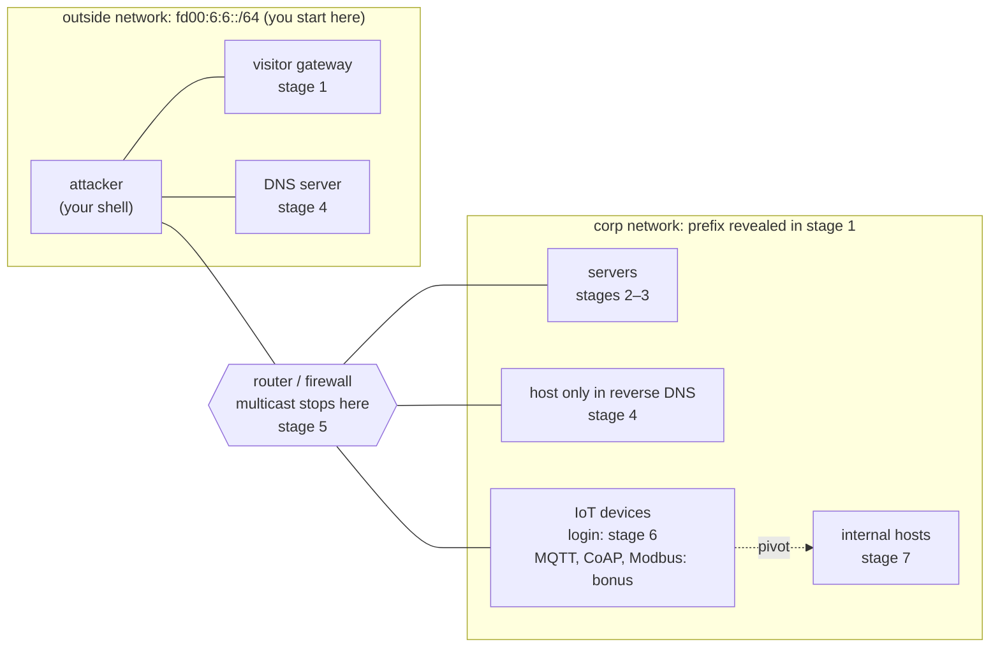

# Lab 3: CoolCorp HQ – IPv6 and IoT

> **Scenario.** After the incident in the cold-storage site (lab 1) you are
> sent to **CoolCorp HQ**. HQ runs IPv6, and its internal network sits behind
> a router. You start outside that network. Sweeping a /64 is hopeless, so you
> have to *find* addresses: by multicast, by guessing the admin's patterns, by
> asking DNS, and finally by looking at the IoT devices, where finding a device
> often means you already have access.

Every stage gives you a `FLAG{...}`. Stages 1–7 are the core of the lab
(about 25 minutes). The bonus (three more IoT devices) is for fast teams. </br>
Stuck? See
[HINTS.md](HINTS.md), one hint per stage.

## Start

```bash
docker compose --profile lab3 up -d --build
docker compose exec attacker bash
```

You are now in the `attacker` container. All scans run from here.

## Networks

| Network | Range | Notes |
| --- | --- | --- |
| outside (`lab`) | `fd00:6:6::/64` (and `172.30.0.0/24`) | where you start |
| corp | revealed in stage 1 | IPv6 only, behind a router; multicast does not cross it |



## Stages

| # | Stage | Technique |
| --- | --- | --- |
| 0 | Try it the IPv4 way | why sweeping a /64 fails (warm-up, no flag) |
| 1 | Find me if you can | multicast discovery (`ff02::1`), neighbour cache, IPv6-only service |
| 2 | Think like the admin | guessable addresses: low-byte, service ports, hex words |
| 3 | The address pool | sequential (DHCPv6-style) addresses: one hit, then the neighbours |
| 4 | Ask the phone book | reverse DNS walk in `ip6.arpa` (NXDOMAIN vs. NOERROR) |
| 5 | Two doors, one lock | dual-stack gap: filtered over IPv4, open over IPv6 |
| 6 | Smart, not secure | find IoT devices via EUI-64 and vendor OUI, then break a default login |
| 7 | Inside job | pivot through an IoT device, then multicast discovery inside corp |
| Bonus | Talk to the machines | MQTT, CoAP and Modbus with nmap NSE scripts (3 flags) |

### Two things you need all the time

- **Discover first, then scan ports.** `nmap -6 -sn` on a list of candidate
  addresses takes seconds. A port scan with `-Pn` on the same list waits for
  every address that does not exist and takes many minutes.
- **nmap has no dash ranges for IPv6** (`fd00:c::1-ff` does not work), but
  small CIDR blocks do. Each hex digit is 4 bits, so `/124` covers the last
  digit and `/120` the last two:

  ```bash
  nmap -6 -sn fd00:c::/120          # fd00:c::0 to fd00:c::ff
  nmap -6 -sn fd00:c::10/124        # fd00:c::10 to fd00:c::1f
  ```

  You can do the same with a small loop:
  ```bash
  for i in $(seq 1 255); do printf 'fd00:c::%x\n' "$i"; done > /work/cand.txt
  ```

  For candidate lists like above, put one address per line in a file and use
  ```bash
  nmap -6 -sn -iL /work/cand.txt
  ```

---

## Stage 0 – Try it the IPv4 way (warm-up)

```bash
nmap -sn 172.30.0.0/24
```

That took a few seconds for 256 addresses. A /64 has 2^64 addresses.
You can try running `nmap -6 -sn fd00:6:6::/64`, but it won't finish.
For the rest of the lab you have to find addresses some other way.
Take note of your own laptop in the `namp` scan's output. Remember its MAC Address, so you don't scan your own device in the next stage.

## Stage 1 – Find me if you can

One host in the outside network listens only on IPv6, on an unusual port, and
its address cannot be guessed. Find it and fetch the flag.

1. Ask every host on the link to answer via IPv6 multicast ping (take a look at the slides for the magic address).
   Then look at your neighbour cache: `ip -6 neigh`.

    **Ignore your own laptop.** One neighbour is your Docker host, i.e. your
    own computer; scanning it shows your own services, not the lab. 
    (Two neighbours are marked `router`: your Docker host and a real router.
    You can identify the Docker host via its hostname or the MAC Address you saw in Stage 0.)

2. Scan the hosts you found with `nmap -6`. One port does not belong there.</br>
   **Remember:** Link-local addresses need the interface: `fe80::…%eth0`.
3. Fetch the flag: `nc -6 <address> <port>`

The banner also tells you where the corp network is and which router leads
there. Your attacker has no route to it yet; add one:

```bash
ip -6 route add <corp prefix> via <gateway>
```

Bonus: scan the same host via IPv4. What is different?

## Stage 2 – Think like the admin

Nobody types random 64-bit interface IDs by hand. Admins pick addresses they
can remember: low numbers (`::1`, `::2`), the service port (`::25` for mail,
`::80` for web) or hex words (`::dead:beef`).

**Goal:** build a list of such candidates in the corp prefix (`fd00:c::/64`), find the live
hosts, scan them. One of them is not a server at all; its banner has the flag.

For the hex words, nmap brings its own wordlist. The NSE
script `targets-ipv6-wordlist` turns it into addresses in the prefix and adds
them to the scan:

```bash
nmap -6 -sn -n -PE --max-retries 1 --min-rate 300 \
  --script targets-ipv6-wordlist \
  --script-args 'newtargets,targets-ipv6-subnet={<corp prefix>}'
```

Almost none of these addresses exist, so the flags `-PE --max-retries 1
--min-rate 300` keep nmap from waiting on each one. In the lab every host
answers ping; on a real network you would add TCP probes (e.g. `-PS22,80,443`)
and scan more slowly.

## Stage 3 – The address pool

Apart from the coffee machine, did you also find the intranet web server in stage 2?

**Hint:**
Use `curl http://[IPv6-address]` to read a web page.

Read it carefully: it leaks one address from the new
DHCPv6 pool.

**Goal:** a server that hands out addresses one after the other leaves its
neighbours right next to the address you know. Find all of them; one of
them has the flag.

## Stage 4 – Ask the phone book

CoolCorp's DNS server is `fd00:6:6::53`. The forward zone `corp.lab` only
lists the official hosts, and zone transfers are blocked. But every IPv6
address can have a PTR record under `ip6.arpa`, one nibble (hex digit) per
label.

**Goal:** walk the reverse zone of the corp prefix and find a host that has
no forward record.

The trick (RFC 8020): ask for a partial name. If nothing exists below it, the
server says `NXDOMAIN`; if something exists further down, it says `NOERROR`.
So you only follow the branches that exist:

```bash
dig @fd00:6:6::53 <nibble>.0.0.0.0.0.0.0.0.c.0.0.0.0.0.d.f.ip6.arpa PTR
```

Shortcut once you have understood it: `atk6-dnsrevenum6`.

## Stage 5 – Two doors, one lock

The router between outside and corp has an admin interface. The admin
blocked it in the firewall. In *a* firewall.

**Goal:** compare `nmap -4` and `nmap -6` against the router's two outside
addresses and read the admin page. It has the flag and something you need for
stage 6.

## Stage 6 – Smart, not secure

A batch of IoT devices configures its addresses with SLAAC. Their interface ID
is built from the MAC address (EUI-64): split the MAC in the middle, insert
`ff:fe`, flip bit 0x02 of the first byte. Example:
`b8:27:eb:12:34:56` → `ba27:ebff:fe12:3456`.

The bit flip only changes the **second hex digit** of the first byte:

| digit | 0 | 1 | 4 | 5 | 8 | 9 | c | d |
| --- | --- | --- | --- | --- | --- | --- | --- | --- |
| becomes | 2 | 3 | 6 | 7 | a | b | e | f |

(and the other way round: `2` → `0`, `a` → `8`, …).

**Goal:** use the clue from stage 5 and the vendor list in
`/usr/share/nmap/nmap-mac-prefixes` to compute the candidate addresses and
find the devices. Then scan them: one of them has a web login and still uses
its factory password. Find the password with nmap and log in; the page shows
the flag.

`nmap -6 -p80 --script http-brute --script-args brute.firstonly=true <address>`
tries common usernames and passwords. Without `brute.firstonly=true` it keeps
going after the first hit. Then log in with `curl -u <user>:<password> 'http://[<address>]/'`.

## Stage 7 – Inside job

Outside the corp network, `ff02::1` only reached the outside hosts. The
device you logged into in stage 6 also has a Telnet shell with the same
account: `telnet <address>`.

**Goal:** log in, then do stage 1 again, but from inside: who answers on the
corp link? Compare with everything you have found so far. Some hosts were never
reachable from outside. One of them has the final flag.

Inside the device you only have `ping`, `nc`, `ip` and `vim`. 

**Hint:** `nc -6 -zv -w1 fd00:c::b2e4:17c9:6a03:f58d 1-10000 2>&1 | grep succeeded`
is a small port scanner.


**Link-local or global answers?** A plain `ping -6 ff02::1%eth0` gets replies
from link-local addresses (`fe80::…`), which you can't compare with the corp
addresses you already know. Send the ping from your own corp address instead
(`ip -6 addr` shows it):

```bash
ping -6 -c2 -I <your fd00:c:: address> ff02::1%eth0
```

Now the hosts answer from their `fd00:c::…` addresses. Why this works:

- `ff02::1` has **link-local scope**: routers never forward it, so the ping
  stays on the corp link whatever source address you use.
- Every host answers to your source address and picks its own source address
  with the same scope (RFC 6724). Your `fe80::` source gets `fe80::` replies;
  your `fd00:c::` source gets `fd00:c::` replies.
- Nothing leaves the link: your address and theirs are on the same link, so
  the replies are single-hop as well.

Skip your own address and `fd00:c::ffff:ffff:ffff:fffe` (Docker's gateway,
i.e. your laptop).

## Bonus – Talk to the machines (3 flags)

The other three IoT devices from stage 6 each speak their own protocol, and
each one gives away a flag to anyone who asks. nmap has an NSE script for
each one:

| Device | Port | NSE script | Client |
| --- | --- | --- | --- |
| MQTT broker | 1883/tcp | `mqtt-subscribe` | `mosquitto_sub` |
| CoAP sensor | 5683/udp | `coap-resources` | `coap-client-notls` |
| Modbus controller | 502/tcp | `modbus-discover` | `mbpoll`, `python3` + `pymodbus` |

CoAP runs over **UDP**, and nmap scans only TCP by default. Without `-sU` the
CoAP device looks like it has no open ports:
`nmap -6 -sU -p5683 --script coap-resources <address>`.

---

## Troubleshooting

- **corp is suddenly unreachable:** the route is gone because the attacker
  container was restarted. Check with `ip -6 route` and add it again (stage 1).
- **`ping ff02::1` gets no answer right after starting:** wait a few seconds,
  the container is still checking its own addresses (duplicate address
  detection).
- **A scan takes forever:** you probably used `-Pn` on a long list. Run
  `-sn` first and scan only the live hosts.

## Rules

Scan only the lab networks (`fd00:6:6::/64`, `172.30.0.0/24` and the corp
prefix). Leave your own Docker host out. No flooding (`-T5`,
`atk6-flood_*`, `ipv6-ra-flood` and similar).

## Stop / Reset

```bash
docker compose --profile lab3 down
docker compose --profile lab3 up -d          # fresh start
```
